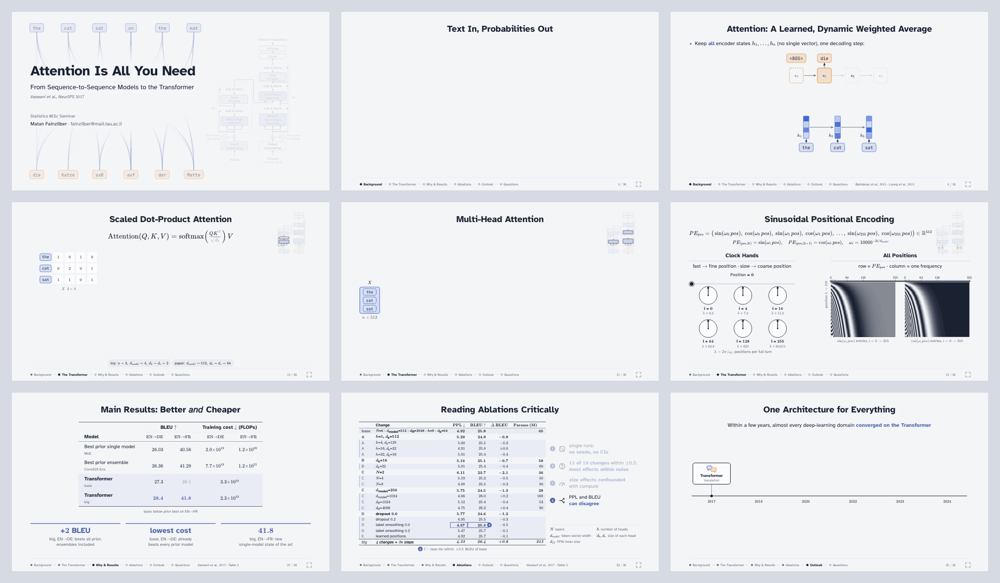
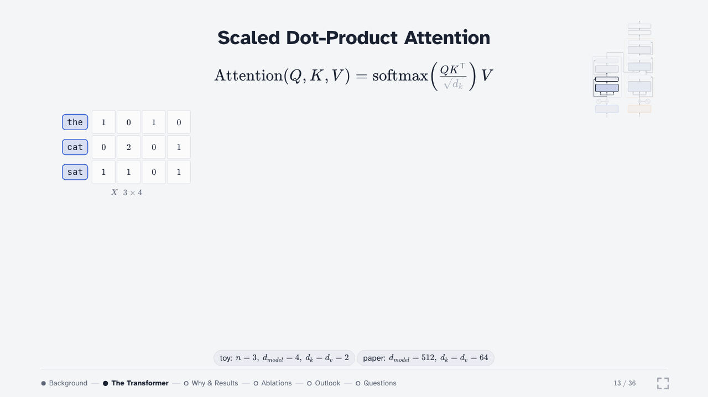
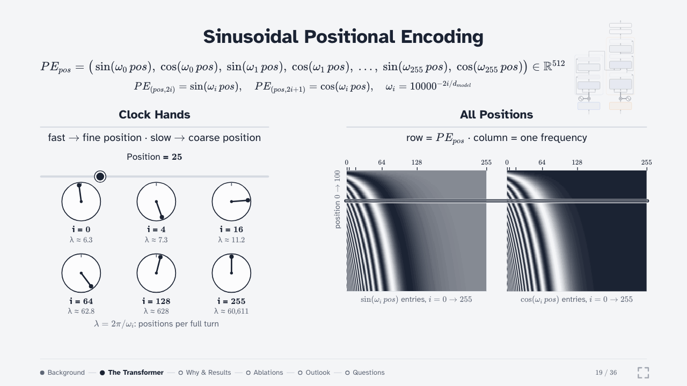
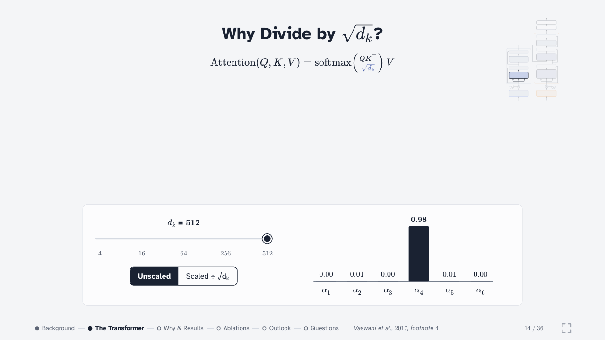
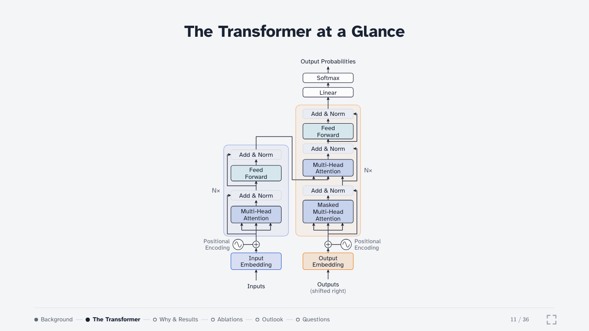
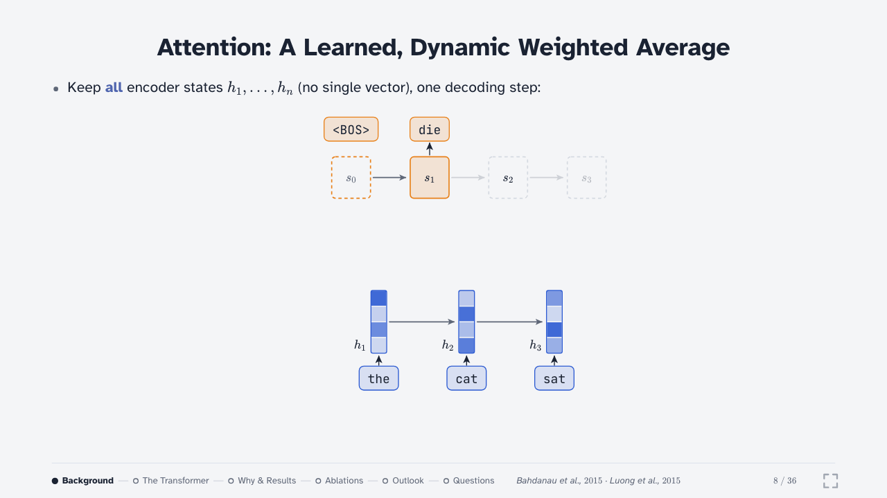
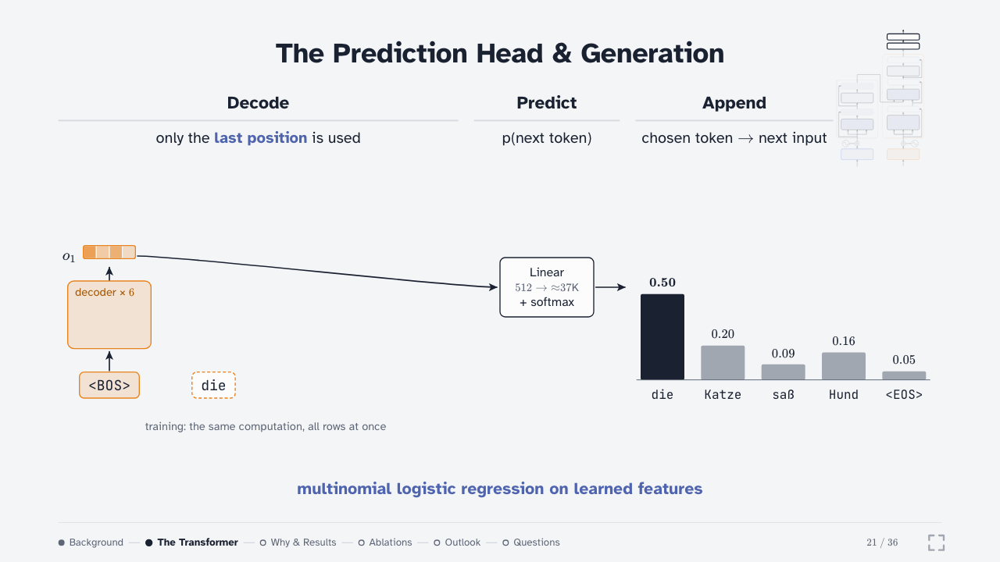

# Attention Is All You Need: an interactive lecture

An interactive lecture on *Attention Is All You Need* (Vaswani et al., 2017): where the Transformer came from, how it works, and what the paper's evidence shows.

<div align="center">
  <a href="https://matfain.github.io/Attention-Is-All-You-Need-Lecture/"></a>
  <a href="https://github.com/matfain/Attention-Is-All-You-Need-Lecture/releases/latest/download/lecture.html"></a>
</div>



## About the lecture

A talk I gave in an M.Sc seminar on impactful papers, part of the Statistics & Data Science program at Tel Aviv University. It starts from sequence-to-sequence models and RNNs, shows how attention removed the fixed-size bottleneck, and then builds the Transformer one component at a time. The second half looks at the paper's evidence: the compute comparison, the translation and parsing results, and a critical reading of the ablations.

Most slides are built up step by step, and the main mechanisms are interactive: the attention matrices use a toy example with exact numbers, and sliders show what √d<sub>k</sub> scaling and positional encoding do. The deck is a single 1.3 MB HTML file that runs offline in a browser.

The slide-by-slide content, with notes on the harder slides, is in [`docs/lecture-content.md`](docs/lecture-content.md).

## Interactive slides

<table>
  <tr>
    <td width="50%"><br><b>Scaled dot-product attention</b> with toy numbers: project, score, softmax, average, update. Click a row to follow one token.</td>
    <td width="50%"><br><b>Positional encoding as clock hands</b>: a position slider drives six frequencies and the full encoding heatmap.</td>
  </tr>
  <tr>
    <td><br><b>Why divide by √d<sub>k</sub></b>: the variance argument next to a live softmax, unscaled vs scaled.</td>
    <td><br><b>The architecture</b>: a tour of Figure 1, which then shrinks into the thumbnail used on later slides.</td>
  </tr>
  <tr>
    <td><br><b>Bahdanau attention</b>: one decoding step at a time, then the full alignment matrix with clickable rows.</td>
    <td><br><b>Generation</b>: the decoder predicts one token at a time from the last position until &lt;EOS&gt;.</td>
  </tr>
</table>

## Building a deck like this with a coding agent

**Start with the content, not the slides.** Understand the paper well enough to explain it without notes, and decide what story the talk tells. The structure should be yours.

**Refine the structure with the agent, top-down.** First the parts, then each slide: what it shows and where its numbers come from. Here that became [`docs/lecture-content.md`](docs/lecture-content.md), which every slide is built from.

**Set up the project for small steps.** One file per slide, every number in a data file, and a [`CLAUDE.md`](CLAUDE.md) with the commands and conventions. A review script screenshots every slide at every build, so the agent can check its own work.

**Iterate in rounds.** Review a slide, give notes, let the agent change it and check the screenshots. For design questions, ask for options with a recommendation and record the decision in the docs.

**Expect trial and error on interactive slides.** The √d<sub>k</sub> widget and the positional-encoding clocks took several versions before they worked on a projector.

More detail: [`docs/framework.md`](docs/framework.md) (engine and build) and [`docs/design.md`](docs/design.md) (visual rules).

## Setup

Requires Node 20 or newer.

```bash
npm install        # dependencies + headless Chromium for the scripts below
npm run build      # → dist/lecture.html
npm run review     # → review/latest/: screenshots + report.txt
npm run gifs       # → assets/media/: the GIFs and images in this README
```

## Repository

```
.
├── src/
│   ├── engine/        deck engine: navigation, builds, footer, scaling
│   ├── components/    drawing helpers: token chips, attention lines, matrices, architecture map
│   ├── slides/        one file per slide, order in manifest.json
│   ├── data/          every number shown on a slide
│   └── styles/        design tokens and styles
├── build/             bundles everything into dist/lecture.html
├── test/              review script (screenshots + checks)
├── scripts/           README media
├── docs/              lecture content, design, framework
├── assets/            fonts, logos, media
├── paper/             the paper (PDF)
└── dist/              the built deck
```

## Credits and license

- Paper: Vaswani et al., *Attention Is All You Need*, NeurIPS 2017, [arXiv:1706.03762](https://arxiv.org/abs/1706.03762). The other sources are on the deck's References slide and in [`docs/lecture-content.md`](docs/lecture-content.md#sources).
- Fonts: Atkinson Hyperlegible and JetBrains Mono (OFL), KaTeX (MIT).
- Code: [MIT](LICENSE). Lecture content (slides, data, docs, media): [CC BY 4.0](LICENSE-content).

Matan Fainzilber · fainzilber@mail.tau.ac.il
